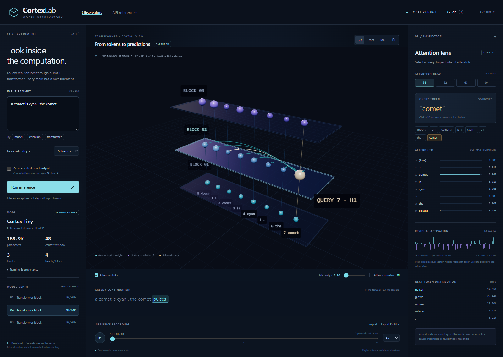
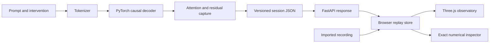

<p align="center"><strong>C O R T E X L A B</strong></p>
<h1 align="center">Look inside the computation.</h1>
<p align="center">An interactive 3D observatory for real PyTorch transformer attention, activations, and recorded inference.</p>
<p align="center">Python · PyTorch · Three.js · WebGL2 · FastAPI · MIT</p>

**Current resource policy:** CPU by default, no automatic CUDA selection, a 10 GiB available-RAM gate before a full CPU Qwen load, and low-power on-demand rendering capped at 15 Hz. The latest dense renderer has been verified with CPU and protocol tests. GPU visual and performance validation is pending.

The new **[Neural Atlas](frontend/neural.html)** is available at `/neural.html` after a deliberately started local server. It contains the dense unit/weight renderer, explicit-run SSE pipeline and replay controls. Eco configures28,672 of229,376 schematic computational sites and up to50K actual weight links. Larger2M/4M capacities are opt-in source capabilities, **not observed GPU results**. Real2M weight extraction was verified directly from the checkpoint on CPU; no full model was loaded for that test. See [dense architecture](docs/NEURAL_ARCHITECTURE.md), [dense verification](docs/NEURAL_TESTING.md) and [Qwen setup](docs/QWEN_DEMO.md).



[Watch the actual application walkthrough (GIF)](docs/images/cortexlab-demo.gif) · [Model card](docs/MODEL_CARD.md) · [Verification evidence](docs/TESTING.md)

CortexLab turns an instrumented transformer forward pass into an inspectable spatial recording. Enter a prompt, select a token inside the 3D model, explore individual attention heads, and replay the exact captured tensors. Zero a head's output and compare a controlled intervention with a same-input baseline.

This is a working local research/education MVP with a **158,912-parameter, locally trained decoder**. Its original 45-token grammar corpus and checkpoint are included. It is a domain-limited educational fixture, not a general-purpose language assistant. No external model download, API key, frontend build, or CDN is required to run the bundled demo after installing Python dependencies.

## What works

- **Real tensor capture:** 3 decoder blocks, 4 heads per block, width 64. Full causal attention `[head, query, key]`, post-block residual vectors `[token, channel]`, L2 norms and next-token probabilities.
- **Direct 3D inspection:** orbit/pan/zoom, camera presets and focus; clickable/hoverable residual nodes; layer/head/query selection; probability-filtered attention arcs and a full attention matrix.
- **Prompt-to-recording pipeline:** bounded FastAPI inference, greedy continuation, explicit unknown tokens and measured forward/capture timings.
- **Replay and portability:** generation-step timeline, play/pause/speed, versioned JSON export/import with shape, causality and finite-number validation. Playback requires no model execution.
- **Controlled intervention:** zero a selected head's weighted value output before projection. Attention probabilities remain observable; first-frame residual changes and predictions compare with the matching baseline.
- **Reproducible evidence:** original corpus, training recipe, hashed safe-loaded checkpoint, recorded demo, mathematical oracle tests, browser acceptance script and CI configuration. The optional Qwen adapter also has a genuine pretrained recording; its old GPU measurements precede the current CPU-only resource policy.

Attention is a routing distribution, not an explanation of model reasoning. Node positions are schematic token/layer coordinates, not an embedding projection or individual neurons. Playback pacing and eased camera transitions do not represent measured GPU execution.

## Run locally

Requirements: **Python 3.10–3.12**, a modern browser with **WebGL2**, and enough disk space for PyTorch. CPU is the supported inference path. Node is optional for JavaScript contract tests, not required to launch the application.

```bash
git clone https://github.com/saygilisoftware/cortexlab.git
cd cortexlab
python -m venv .venv
```

Activate the virtual environment:

```powershell
# Windows PowerShell
.\.venv\Scripts\Activate.ps1
```

```bash
# macOS / Linux
source .venv/bin/activate
```

Install and start:

```bash
python -m pip install torch==2.6.0 --index-url https://download.pytorch.org/whl/cpu
python -m pip install -r requirements.txt
python -m uvicorn backend.app:app --host 127.0.0.1 --port 8000
```

Open **http://127.0.0.1:8000**. The real bundled recording loads automatically. Interactive API documentation is at **http://127.0.0.1:8000/docs**.

The clone URL above is the intended repository location; this work has not created or pushed a remote repository. A downloaded source checkout works identically. Installation needs package-registry access once; the running application serves its model and JavaScript assets locally. Clean online installation and Linux CI were not executable in the restricted development session; see [verification](docs/TESTING.md).

## A two-minute experiment

1. Run `a comet is cyan . the comet` with 6 requested tokens. Generation stops at `<eos>`; this checkpoint produces `pulses.`.
2. Select **block 02 / head 01** and the last input token. Click another node to change the actual query. Compare each arc with its exact probability in the inspector.
3. Open **Attention matrix**. Future-token cells are causally masked. Scrub the timeline: the next step includes the previous prediction as a new input token.
4. Return to step one, choose **block 01 / head 02**, check **Zero selected head output**, and run the same prompt. Inspect the first-frame residual difference and prediction relative to the baseline. This demonstrates an intervention, not automated circuit discovery.
5. Export JSON and import it again. The recording contains the full measured tensors and checkpoint hash; no inference runs on import.

Useful prompts: `the violet crystal`, `observe the comet . its color is`, `attention mixes`, `a transformer predicts the`. Other words become explicit `<unk>` tokens. Maximum prompt length is 400 characters; prompt tokens plus requested generation must fit 48 tokens. Generation is limited to 1–8 tokens. See [demo guide](docs/DEMO.md).

## Architecture



| Boundary | Implementation |
|---|---|
| Algorithm and tokenization | `backend/model.py` |
| Model provenance, capture and recording | `backend/engine.py` |
| Bounded HTTP and static delivery | `backend/app.py` |
| Browser recording validation | `frontend/src/contracts.js` |
| UI, selection, replay and comparisons | `frontend/src/main.js` |
| Graphics and presentation transitions | `frontend/src/scene.js` |
| Training and real demo generation | `scripts/train.py`, `scripts/record_demo.py` |

The UI receives complete recordings, not streamed tokens. Prefixes are recomputed at each generation step, without KV caching. The versioned session is the extension point for future pretrained/TransformerLens adapters. See [architecture and tensor axes](docs/ARCHITECTURE.md), [decisions](docs/DECISIONS.md), and [research](docs/RESEARCH.md).

## Validate and reproduce

```bash
# Mathematical correctness, learned-checkpoint metrics, recording and API tests
python -m pytest -q

# Regenerate a real recording from the shipped checkpoint
python scripts/record_demo.py

# 3 warm-ups + 30 measured engine recordings; writes JSON evidence
python scripts/record_demo.py --benchmark

# Optional browser validation (starts and stops its own local server)
python -m pip install -r requirements-dev.txt
python -m playwright install chromium
python scripts/e2e.py

# Capture an actual sampled browser walkthrough as GIF (Pillow + Playwright)
python scripts/capture_demo.py

# Optional Node 20.19+ contract checks, no npm installation
node --test tests/contracts.test.mjs
```

If using an installed Chrome instead of Playwright Chromium: `python scripts/e2e.py --channel chrome`. Test artifacts include actual desktop/mobile screenshots and `examples/browser-validation.json`. To retrain the fixture, run `python scripts/train.py` then `python scripts/record_demo.py`; this replaces the bundled model/metadata/demo. Seeded CPU training is reproducible within the recorded runtime, not guaranteed bit-identical across platforms or PyTorch versions.

The checkpoint's held-out next-token accuracy is **57.84%**, versus a **18.65%** majority-token baseline (47 held-out grammar sequences). The core tests recompute its evaluation from the weights. A 30-sample warm CPU engine benchmark measured **4.66 ms median / 5.30 ms p95**, excluding HTTP and graphics, for a separate short-prompt scenario. These are local results, not universal latency claims. Detailed methods and raw evidence: [testing](docs/TESTING.md), [performance](docs/PERFORMANCE.md).

## Scope and roadmap

The verified tensor lens supports the original fixture plus a local Qwen3-1.7B adapter. The new dense pipeline implements explicit inference jobs and resumable token SSE, bounded history/cache, cancellation and a separate binary weight protocol. It is CPU-tested; full-model dense captures and dense GPU drawing still require validation on suitable hardware. Arbitrary pretrained architectures, KV caching, automatic causal attribution, multi-user deployment and production hosting are not supported. Scientific novelty and educational usability have not been established by a user study. Existing tools such as BertViz, Transformer Explainer, TransformerLens, Netron and circuit-tracer provide substantial prior art; [competitive research](docs/COMPETITORS.md) explains the intended workflow distinction.

Next: a pinned, licensed pretrained adapter; explicit session-to-session tensor alignment; controlled-intervention sweeps; accessibility/usability validation; broader browser/OS coverage. See [roadmap](docs/ROADMAP.md), [contributing](CONTRIBUTING.md), [security](SECURITY.md), and [portfolio notes](docs/PORTFOLIO.md).

## License and provenance

Original CortexLab code, authored corpus and locally trained fixture: **[MIT](LICENSE)**. Three.js/OrbitControls are vendored under MIT with [source provenance](frontend/vendor/PROVENANCE.md). Python dependencies retain their own licenses; see [third-party notices](THIRD_PARTY_NOTICES.md). 0xLane and traceon-replay informed architectural principles; no implementation code or assets were copied from them. The unrelated traceonmarketing project is outside CortexLab's scope and contributes no code or assets.

To create a clean source archive without environments, caches or local recordings: `python scripts/package_release.py`.
